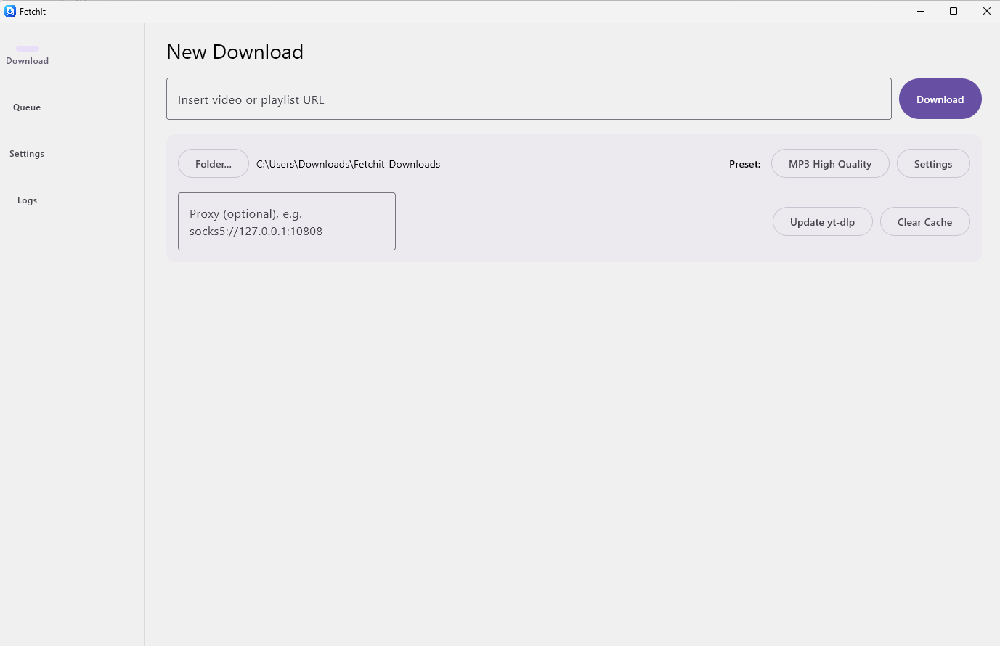
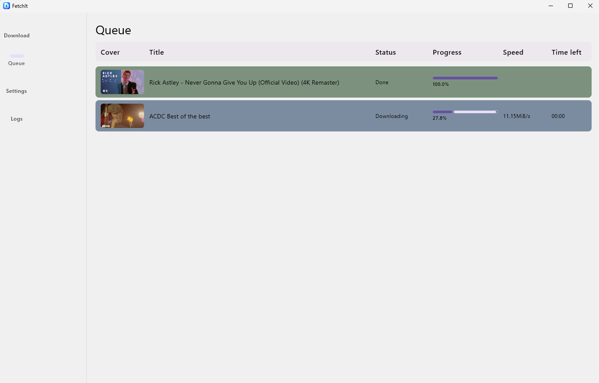
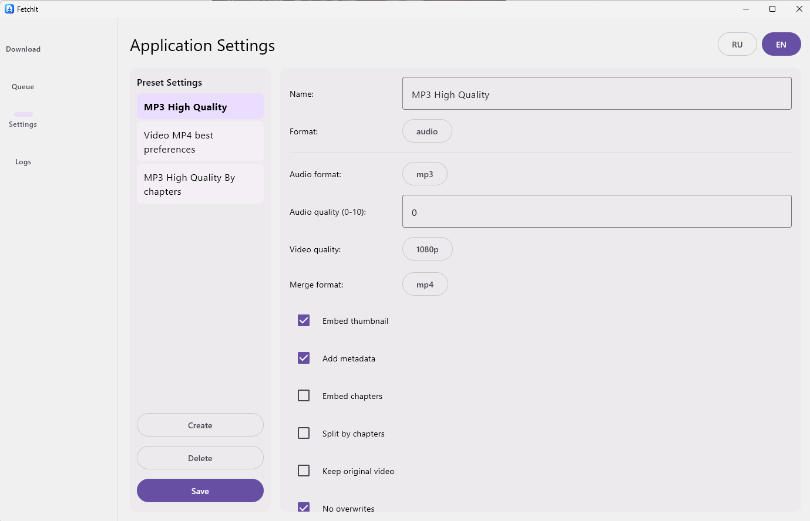
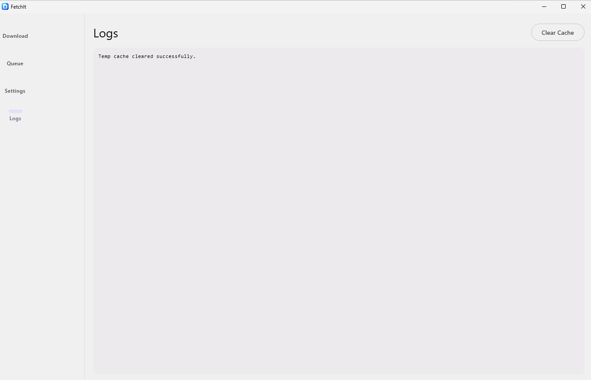

# FetchIt

**A feature-rich graphical user interface for `yt-dlp`**

FetchIt is a desktop GUI application for the popular command-line downloader `yt-dlp`. It is designed for users who want the full power of `yt-dlp` without having to memorize dozens of CLI flags.

[](https://github.com/TheTaktika/Fetchit/releases)
[](https://github.com/TheTaktika/Fetchit/actions)
[](https://kotlinlang.org/)
[](https://jdk.java.net/21/)
[](https://opensource.org/licenses/MIT)

---

##  Table of Contents

- [Features](#-features)
- [Screenshots](#-screenshots)
- [Installation](#-installation)
- [Usage](#-usage)
- [Presets & Formats](#-presets--formats)
- [Dependencies](#-dependencies)
- [Compiling from Source](#-compiling-from-source)
- [License](#-license)

---

##  Features

- **Audio and Video Extraction**: Support for MP3, FLAC, M4A, MP4, MKV, and WEBM.
- **Smart Presets**: Create custom profiles (e.g., "High-Quality Audio" or "1080p Video") and switch between them with one click.
- **Duplicate Check**: FetchIt reads video IDs from the metadata of already downloaded files to avoid re-downloading them (perfect for updating playlists).
- **Human-Readable Errors**: A built-in classifier translates technical `yt-dlp` errors into plain language (e.g., "Video unavailable in your region").
- **Internationalization (i18n)**: Full support for English and Russian languages with on-the-fly switching.
- **Detailed Progress**: Separate indicators for overall playlist progress and the current downloading file.
- **Bundled Dependencies**: The installer includes `yt-dlp`, `ffmpeg`, and `gjs`. No manual system setup is required.

---

##  Screenshots

|            Download View            |          Queue View           |
|:-----------------------------------:|:-----------------------------:|
|  |  |
|            **Settings**             |           **Logs**            |
|       |         |

---

##  Installation

### Release Files (Recommended)

Go to the [Releases](https://github.com/TheTaktika/Fetchit/releases) page and download the latest `.msi` installer.

| File                | Description                                                                                 |
|:--------------------|:--------------------------------------------------------------------------------------------|
| `FetchIt-x.x.x.msi` | Ready-to-use Windows installer (x64). Includes embedded JRE, `yt-dlp`, `ffmpeg`, and `gjs`. |

### Update

FetchIt checks for updates of the embedded `yt-dlp` via the program interface (the "Update yt-dlp" button). To update the application itself, simply download the new `.msi` installer from the Releases section and install it over the old version.

---

##  Usage

1. Launch FetchIt.
2. Paste the link to a video or playlist into the top field (thousands of sites compatible with `yt-dlp` are supported).
3. Select the destination folder and the desired settings preset.
4. Click **"Download"**.

**Playlist Downloading:**
If you paste the link to a playlist that is already partially downloaded, FetchIt will scan the folder, read the IDs from the metadata, and download **only the new** or missing videos.

---

##  Presets & Formats

FetchIt uses a preset system that replaces complex CLI arguments of `yt-dlp`.

In the "Settings" window, you can combine the following parameters:
- **Format**: `audio` (audio only) or `video` (video file).
- **Audio Format**: `mp3`, `m4a`, `flac`, `opus`, `wav`.
- **Audio Quality**: from `0` (best) to `10` (worst).
- **Video Quality**: `best`, `2160p` (4K), `1080p`, `720p`, `480p`, etc.
- **Metadata**: Embed thumbnail (`--embed-thumbnail`), tags (`--add-metadata`), and chapters (`--embed-chapters`).
- **Subtitles**: Save as a separate file or embed into the video.
- **SponsorBlock**: Automatically remove sponsor segments from YouTube videos.
- **Network**: Specify proxy, rate limits, and concurrent fragments.

---

##  Dependencies

FetchIt uses the following tools to operate. They are **already included** in the release installer but are required when building from source (place them in the `bundle/` folder):

- **[yt-dlp](https://github.com/yt-dlp/yt-dlp)**: The core download engine.
- **[ffmpeg](https://ffmpeg.org/) / ffprobe**: Required for audio conversion, video merging, and metadata embedding.
- **[GJS](https://gjs.guide/)**: JavaScript runtime (GNOME JavaScript) required to bypass modern YouTube protections and solve PO Token challenges.

---

##  Compiling from Source

**Requirements:**
- JDK 21 (LTS)
- Gradle (the project includes a Gradle Wrapper, so a local installation is not strictly necessary)
- WiX Toolset 3.x (Windows only, required for creating `.msi` installers)

**Run in development mode:**

* On Windows:
  ```bash
  gradlew.bat run